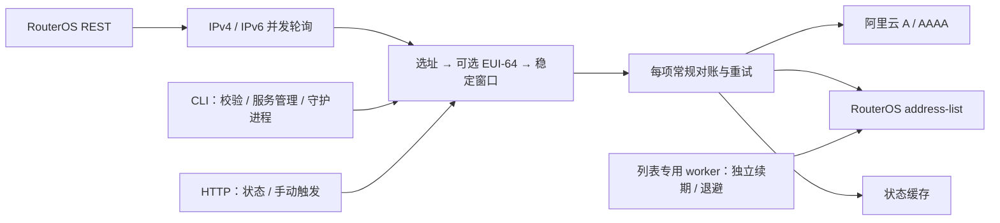
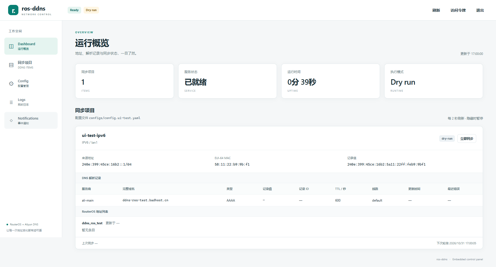

# ros-ddns

用 Go 编写的动态 DNS 守护进程：从一台 RouterOS 7 路由器读取接口地址，维护阿里云解析（Alidns）的 A / AAAA 记录，并可选同步 RouterOS 防火墙 `address-list`。

## 功能与工作方式

- IPv4、IPv6 各有独立的并发轮询循环、退避和唤醒通道，同族条目共享一次地址读取；默认轮询间隔 `10s`。
- 每个 `item` 选择一个源值，可绑定多个 `domains[]` 和一个 `addressList`，也可只维护列表。
- `source.family` 自动决定 A / AAAA；IPv6 可用 `eui64-mac` 派生地址。配置没有 `version` 和记录 `type` 字段。
- 新值经过 `stableFor` 后对账；支持启动校验、周期校验、手动触发和失败重试。成功目标保留，失败目标重试。
- DNS 只新增或更新；多条记录匹配且没有有效缓存 RecordId 提示时拒绝写入。
- 地址列表以精确 `comment` 标识所有权，修复受管条目的地址、启用状态、静态 / 动态标志和期限；配置列表的启用项有专用续期 worker，不调用 DNS，也不等待 DNS 请求或退避。
- 提供 CLI、HTTP 健康检查、状态查询和手动同步；状态缓存默认保存到 `./data/state.json`。
- 守护进程使用 OS 单实例锁，默认锁为 `state.path + ".lock"`，避免同一部署重复运行。



守护进程先取得单实例锁，再初始化服务、成功绑定 HTTP API，之后开始轮询和对账。默认 `syncOnStart: true`、`verifyInterval: 10m`；强制对账仍要求源地址可用且稳定。详细流程见 [架构设计](docs/architecture.md)，原生服务管理（systemd / Windows 服务）与 Docker 安装运维见 [生产部署指南](docs/deployment.md)。

## WebUI

同一个 Go 二进制内嵌响应式 WebUI，与 API 共用监听地址，无需 Node、前端构建或外部 CDN。守护进程启动后打开 `http://<api.listen>/`（默认 `http://127.0.0.1:8080/`）；设置 token 时按提示登录。支持状态卡片与手动同步、**左侧「同步项目」独立配置页**、Config 表单编辑及热重载、实时日志和页内通知中心。API 监听地址、token 与日志格式需重启生效。

启动、鉴权、配置备份与冲突处理、API 和验收记录见 [WebUI 使用指南](docs/webui.md)。



## 快速开始

### 1. 准备环境

准备支持 REST 的 RouterOS 7、专用账号和 HTTPS 证书；HTTP `www` 的 REST 支持从 7.9 开始，只用于隔离测试。部署步骤见 [RouterOS 指南](docs/routeros-setup.md)。DNS 目标需要托管在阿里云解析中，并准备有查询、新增、更新权限的 RAM 凭据，见 [阿里云指南](docs/aliyun-setup.md)。源码构建需要 Go 1.26.2 或更高版本，版本要求见 [go.mod](go.mod)。

### 2. 注入凭据并编辑配置

程序读取进程环境变量，不自动加载 `.env`。以下占位值需替换；使用 STS 时还要设置 `ALI_SECURITY_TOKEN`。以服务方式运行时进程不继承 shell 环境，凭据应直接写入配置文件（`0600`）或启动后在 WebUI 中配置；缺少或错误的凭据不会阻止服务启动，只会在同步时记录错误并重试。

```powershell
# Windows PowerShell，仓库根目录
$env:ROS_PASSWORD = '替换为路由器密码'
$env:ALI_ACCESS_KEY_ID = '替换为 AccessKey ID'
$env:ALI_ACCESS_KEY_SECRET = '替换为 AccessKey Secret'
$env:ROS_DDNS_API_TOKEN = '替换为随机长 token'
New-Item -ItemType Directory -Force build\configs, build\secrets | Out-Null
Copy-Item configs/config.example.yaml build/configs/config.local.yaml
```

```bash
# Linux，仓库根目录
export ROS_PASSWORD='替换为路由器密码'
export ALI_ACCESS_KEY_ID='替换为 AccessKey ID'
export ALI_ACCESS_KEY_SECRET='替换为 AccessKey Secret'
export ROS_DDNS_API_TOKEN='替换为随机长 token'
mkdir -p build/configs build/secrets
cp configs/config.example.yaml build/configs/config.local.yaml
```

修改 `build/configs/config.local.yaml` 中的 RouterOS URL、用户、接口、域名和可选 MAC。示例显式设置 `tls.insecureSkipVerify: true`，代码默认是 `false`；部署时使用可信证书，或设为 `false` 并提供 `caFile`。URL 只填写 origin 加可选基础路径，不带 userinfo、查询串、fragment 或末尾 `/rest`。

凭据也可以写入 `build/secrets/ros-ddns.env`（每行 `KEY=VALUE`，权限保持仅本用户可读）；`scripts/dev.ps1` 启动前会加载该文件，不必每次手工导出环境变量。该目录已被 git / Docker 忽略，且不属于可删除的调试产物。

环境变量在 YAML 解析后对标量展开，注释不展开；支持 `${VAR}`、`${VAR:-default}`、`$$`。已设置的变量即使为空也优先于默认值。空格、`#`、冒号、引号和换行会保留为字符串内容；数字、布尔字段必须直接写 YAML 字面量。完整规则见 [配置参考](docs/configuration.md#2-环境变量展开)。

### 3. 校验与构建

```powershell
# Windows：Go 命令经包装脚本使用仓库内缓存
.\scripts\go.cmd run ./cmd/ros-ddns -config build/configs/config.local.yaml -check
.\scripts\go.cmd build -o build/bin/ros-ddns.exe ./cmd/ros-ddns
```

```bash
# Linux
go run ./cmd/ros-ddns -config build/configs/config.local.yaml -check
go build -o build/bin/ros-ddns ./cmd/ros-ddns
```

`-check` 只加载和校验配置，stdout 是人类可读的 Summary，凭据显示 `set` / `unset`。它不获取单实例锁，不连接 RouterOS 或阿里云，不读取 CA 文件内容，也不检查状态目录可写性；它**不会创建或修改配置文件**。

### 4. 持续运行

以下命令会实际对账，必要时修改 DNS 和地址列表。

```powershell
# 持续运行，Ctrl+C 停止
.\build\bin\ros-ddns.exe -config build/configs/config.local.yaml
```

```bash
./build/bin/ros-ddns -config build/configs/config.local.yaml
```

手动或服务方式启动守护进程时，如果配置文件不存在，程序会在配置路径生成一份内嵌默认配置（`0600`，`state.path` 为配置文件目录下的绝对路径），并在默认 `127.0.0.1:8080` 上提供 WebUI，可直接打开完成配置。配置文件存在但无法加载时：手动运行报错并退出 `2`；服务方式会保留原文件为 `.invalid-<时间戳>` 后生成默认配置并继续启动（详见下节）。单次触发对账改用 WebUI/API 的“立即同步”，不再提供单轮执行模式。

持续运行时，SIGINT / SIGTERM 会取消轮询、对账和等待，优雅关闭 HTTP 服务，随后释放锁。锁文件保留用于诊断，重新启动无需删除；不要在运行中删除或替换它。部署服务的停启、升级与回滚见 [生产部署指南](docs/deployment.md)。

### 5. 查询状态与手动触发

默认 API 为 `127.0.0.1:8080`。设置 token 后，整个 `/api/v1` 命名空间要求 `Authorization: Bearer <api.token>`；`/healthz`、`/readyz` 公开。

```bash
curl -sS -i http://127.0.0.1:8080/healthz
curl -sS -i http://127.0.0.1:8080/readyz
curl -sS http://127.0.0.1:8080/api/v1/status \
  -H "Authorization: Bearer $ROS_DDNS_API_TOKEN"
curl -sS -X POST http://127.0.0.1:8080/api/v1/items/home-ipv4/sync \
  -H "Authorization: Bearer $ROS_DDNS_API_TOKEN"
```

```powershell
curl.exe -sS http://127.0.0.1:8080/api/v1/status -H "Authorization: Bearer $env:ROS_DDNS_API_TOKEN"
curl.exe -sS -X POST http://127.0.0.1:8080/api/v1/items/home-ipv4/sync -H "Authorization: Bearer $env:ROS_DDNS_API_TOKEN"
```

| 请求 | 响应 |
| --- | --- |
| `GET /healthz` | `200`，`{"ok":true}` |
| `GET /readyz` | 已 ready 为 `200`，否则 `503`；`{"ready":true}` / `{"ready":false}` |
| `GET /api/v1/status` | `200`，`service.Snapshot` JSON |
| `POST /api/v1/items/{name}/sync` | `202`，`{"status":"accepted","name":"home-ipv4"}`；未知或禁用项为 `404`，`{"error":"item not found"}` |

手动触发只表示合并排队一次强制对账，同时唤醒源轮询、重置其退避；`202` 不表示同步完成。鉴权失败返回 `401` JSON 和 `WWW-Authenticate: Bearer`，token 使用固定长度摘要的常量时间比较。未知路径 `404` / 方法错误 `405` 也返回 JSON。配置、日志及通知接口见 [WebUI API 参考](docs/webui.md#3-http-api-参考)。

Ready 表示本次运行中所有启用项已完成至少一次成功的源轮询；无合格地址也算，磁盘状态不算。后续源读取失败不会撤销此标记。判断同步情况应查看 `items[].phase`、`lastError` 和各目标结果，不能只看 ready。完整 JSON 字段见 [API 与状态](docs/architecture.md#10-http-api-与状态结构)。

## CLI 合同

| 参数 | 默认值 | 行为 |
| --- | --- | --- |
| `-config` | `config.yaml` | 配置路径，相对当前工作目录 |
| `-lock-file` | 空（自动选择） | 非空时指定锁路径；否则使用 `state.path + ".lock"`，内存状态模式使用规范配置路径（解析符号链接，Windows 统一大小写）SHA-256 前 8 字节派生的临时文件 |
| `-check` | `false` | 静态校验，输出文本摘要后退出；不创建或修改配置文件 |
| `-version` | `false` | 输出版本、提交和构建时间，无需加载配置 |
| `-service` | 空 | 服务管理动作：`install` / `uninstall` / `start` / `stop` / `restart` / `status`；与 `-check` 互斥 |
| `-service-user` | 空 | `install` 时记录的服务账号（Linux systemd `User=`，Windows 服务账号；缺省使用系统默认账号） |

`-version` 优先于 `-check`，`-check` 优先于运行模式。日志与诊断写 stderr，摘要和版本写 stdout。服务动作优先于常规运行模式，且不会加载配置（`install` 只记录路径）。`-once` 与 `-dry-run` 已移除：手动触发对账请使用 WebUI / API 的“立即同步”。

锁在任何服务或监听器创建前获取；冲突立即退出，可读时报告持有者 PID、启动时间和配置路径。`state.path` 热重载不会移动已持有的锁，应停服改路径再启动。服务安装记录的启动参数与 Docker 部署在启动命令中固定了 `-lock-file`。临时锁的精确命名和作用范围见 [单实例锁](docs/deployment.md#1-单实例锁)。

| 退出码 | 含义 |
| --- | --- |
| `0` | 成功（含正常停止、无错误的 `-check`） |
| `1` | 获取锁、初始化、监听或运行失败 |
| `2` | 参数或配置错误，包括未知字段、缺失环境变量、非法端口、配置路径冲突等 |

守护进程中的条目失败会持续重试，不会仅因条目 degraded 就退出。API 绑定失败返回 `1`，不会开始轮询或写 RouterOS。

## 服务管理（systemd / Windows 服务）

二进制内置服务管理（`github.com/kardianos/service`），仓库不再提供 unit 文件或安装脚本。安装与控制动作需要 root / 管理员：

```bash
# 先把二进制安装到稳定路径（见生产部署指南），再注册服务
sudo /usr/local/bin/ros-ddns -service install \
  -config /var/lib/ros-ddns/config.yaml \
  -lock-file /var/lib/ros-ddns/state.json.lock \
  -service-user ros-ddns
sudo /usr/local/bin/ros-ddns -service start
sudo /usr/local/bin/ros-ddns -service status
```

| 动作 | 行为 |
| --- | --- |
| `-service install` | 注册并启用服务；只记录绝对 `-config` / `-lock-file`，不启动、不读取配置 |
| `-service start` / `stop` / `restart` | 启停；start / stop 幂等，restart 未运行时等价 start |
| `-service status` | 输出 `platform=... name=ros-ddns status=running\|stopped\|not-installed`；running 退出 `0`，其余退出 `1` |
| `-service uninstall` | 先停止，再注销并移除 unit / Windows 事件源；保留配置文件、状态与账号 |

开箱即用行为：

- 配置文件不存在时，**任何**守护进程启动（手动运行或服务方式）都会生成内嵌默认配置（`0600`，`state.path` 为配置文件目录下的绝对路径；默认 `api.listen: 127.0.0.1:8080`、token 为空）；打开 `http://127.0.0.1:8080/` 用 WebUI 完成配置。默认配置含占位条目，配置完成前会周期性报错，这是预期行为。`-check` 不会生成配置文件。
- 配置文件存在但无法加载（YAML / 结构错误、`${VAR}` 未展开等）时：服务方式将原文件保留为 `config.yaml.invalid-<时间戳>`，写入默认配置后继续启动，日志与通知中心给出两个路径；手动运行则报错退出 `2`，不修改原文件。
- 凭据缺失或错误、RouterOS / 阿里云不可达不会阻止启动：相关条目进入 degraded，日志与页内通知记录错误并退避重试，修复配置（WebUI 保存热重载）后自动恢复。
- 服务方式不继承 shell 环境，配置中的 `${VAR}` 需由服务管理器自行提供；推荐直接写凭据字面值或在 WebUI 中配置。`api.listen`、`api.token`、`log.format` 修改需要 `-service restart`。
- 服务模式下相对路径以配置文件所在目录为基准（进程启动即切换到该目录）；推荐使用绝对路径。
- 日志：Linux 用 `journalctl -u ros-ddns.service`；Windows 的服务生命周期错误进事件查看器，运行期日志见 WebUI。安装权限、升级、加固 drop-in 与卸载细节见 [生产部署指南](docs/deployment.md#2-原生服务管理systemd--windows-服务)。

## 本地目录约定（build/）

源码区只保留源码、文档和项目元数据；构建产物、Go 缓存、本地配置、运行状态、日志、凭据与调试文件统一放在 `build/`（已被 `.gitignore` 和 `.dockerignore` 忽略，不要提交）：

| 路径 | 内容 | 可删除性 |
| --- | --- | --- |
| `build/bin/` | 构建产物（`ros-ddns.exe`、Linux 交叉编译） | 可删，重新构建即可 |
| `build/.go-cache/` | Go 缓存（`GOPATH` / `GOMODCACHE` / `GOCACHE`）；隐藏目录，避免被 `go ./...` 扫成包 | 可删，下次构建变慢 |
| `build/configs/` | 本地配置 `config.local.yaml` 及 WebUI 保存生成的 `.bak` | 需保留或自行备份 |
| `build/data/` | 本地实例状态缓存与单实例锁 | 需保留（含 RecordId 恢复线索） |
| `build/logs/` | 守护进程运行日志 | 可删 |
| `build/secrets/` | 本机凭据 `ros-ddns.env` | **不可删**，保持仅本用户可读 |
| `build/tmp/` | 一次性调试产物（`-check` 输出、截图、脚本） | 可随时整体删除 |

`make clean` 只删除 `build/bin`，`make clean-tmp` 删除 `build/tmp` 与 `build/logs`，`make clean-cache` 删除 Go 缓存；三条目标都不会碰配置、状态和凭据。手动开发推荐用 `scripts\dev.cmd`（Windows，内部以 `-ExecutionPolicy Bypass` 调用 `scripts/dev.ps1`，不需要修改系统执行策略）：它从 `build/secrets/ros-ddns.env` 注入环境变量，支持 `-Check` / 默认后台守护两种模式，日志写入 `build/logs/`，`-Stop` 停止已启动的实例。

## 构建与 Makefile

```bash
# 构建元数据示例，按发布内容替换
make build VERSION=v0.1.0 COMMIT=local BUILD_DATE=2026-10-31T00:00:00Z
```

Makefile 通过 `-ldflags -X` 注入 `ros-ddns/internal/version.Version`、`ros-ddns/internal/version.Commit`、`ros-ddns/internal/version.BuildDate`；默认分别为 `dev`、`unknown`、`unknown`。运行生成的程序加 `-version` 查看。Windows 默认调用 `scripts\go.cmd`，Linux 默认调用 `go`；`GO`、`BIN` 可覆盖。

| target | 行为 |
| --- | --- |
| `build` | 构建到 `build/bin/ros-ddns.exe`（Windows）或 `build/bin/ros-ddns`（Linux） |
| `build-linux` | 静态交叉编译 Linux amd64 到 `build/bin/ros-ddns-linux-amd64`，可用 `LINUX_BIN` 覆盖输出 |
| `docker-build` | 构建多阶段容器镜像，默认 `ros-ddns:local`，可用 `IMAGE` 覆盖 |
| `test` / `vet` | 执行全部测试 / 静态检查 |
| `fmt` | `gofmt -l -w cmd internal`，会改写 Go 文件 |
| `check` | 依赖 `fmt vet test`，包含格式化写入；与程序的 `-check` 不同 |
| `run` | 先构建，再用 `configs/config.example.yaml` 运行，需设置环境变量并核对示例目标 |
| `clean` | 只删除 `build/bin` |
| `clean-tmp` | 删除 `build/tmp` 与 `build/logs`（一次性调试产物） |
| `clean-cache` | 删除 `build/.go-cache`（下次构建重新生成） |

部署构建目标面向 Linux / CI；Windows 没有 make 时直接使用 Go 交叉编译，见 [构建与部署](docs/deployment.md#21-前提与构建)。

## 安全与运行边界

配置摘要隐藏凭据值；服务将已配置的 RouterOS 密码、API token、AccessKey ID / Secret、STS token 从错误日志、状态和缓存错误中脱敏为 `[redacted]`，覆盖原值、JSON 字符串转义及 URL query 转义表示。长匹配值按子串处理，短匹配值按有边界的 token 处理，避免破坏普通诊断词；环境变量展开后的错误也会清洗。这不保证任意上游错误、上述变体以外的编码形式或放在非凭据字段的秘密都被识别。

API 默认回环监听；非回环地址必须设置非空 `api.token`。远程使用时应限制来源并通过 HTTPS 代理访问。配置文件、日志和 `state.path` 需限制读取权限：状态 JSON 仍可能包含域名、IP、RecordId、MAC、接口名和本地配置路径。状态没有凭据字段，但并非可公开的数据。

## 已知限制

- 一个进程连接一台 RouterOS，同一部署只运行一个实例。确需多个独立部署时，必须隔离远端目标、配置、API 端口、状态和锁文件；不同锁不会协调相同远端目标，不能用换锁绕过冲突。此锁不是跨主机的分布式协调。
- 轮询、防抖、请求、重试决定云端更新时间；DNS 缓存另外受 TTL 影响。默认 TTL 为 600 秒，阿里云套餐限制见 [TTL 说明](docs/aliyun-setup.md#5-ttl-与套餐限制)，不保证固定的全网生效时间。
- DNS 没有删除或孤儿清理；删除配置、改 RR / domain / provider / line 可能留下旧记录。禁用 DNS 记录的启用状态也不会自动修复。
- 无可用源时不主动清空目标。动态列表在 RouterOS 不可达、源不可用、程序停止或路由器重启时仍可能过期 / 消失，恢复后再补回；续期是尽力而为。`verifyInterval: 0s` 仍保留独立动态续期。
- 列表只修改精确 comment 的受管项，先删后加，切换存在短暂空缺。外部启用的同主机条目可满足目标；外部禁用的匹配条目产生冲突并使该项 degraded，需人工处理。其他子网不能代替目标主机。改 list / comment 后旧作用域不会清理，也不保证清除所有重复项。
- EUI-64 只合成地址，不分配地址、不保证可达。测试向量：`2001:db8:1234:5678::/64` + `00:1A:2B:3C:4D:5E` → `2001:db8:1234:5678:21a:2bff:fe3c:4d5e`。这是文档地址；目标若使用隐私地址或非 MAC IID，必须核实实际地址，见 [EUI-64 说明](docs/routeros-setup.md#7-ipv6-与-eui-64-注意事项与验证)。
- 当前只支持阿里云 A / AAAA，没有其他 DNS provider 或 RouterOS 6 原生 API。WebUI 表单保存支持配置热重载，但 `api.listen`、`api.token`、`log.format` 需重启；进程环境中的 STS 等凭据更新也需重新注入并重启，详见 [热重载边界](docs/webui.md#4-热重载与就绪状态)。

## 文档导航

- [生产部署指南](docs/deployment.md)：单实例锁、原生服务管理（systemd / Windows）、Docker、目录权限、健康检查、升级与回滚。
- [WebUI 使用指南](docs/webui.md)：页面操作、表单配置、热重载、API、实时日志与页内通知。
- [配置参考](docs/configuration.md)：完整字段、默认值、显式零值、环境变量与校验。
- [架构设计](docs/architecture.md)：组件、并发轮询、状态机、对账、续期、失败模型与 API 字段。
- [RouterOS 配置指南](docs/routeros-setup.md)：HTTPS、权限、REST 冒烟测试、列表生命周期和手工验收。
- [阿里云配置指南](docs/aliyun-setup.md)：RAM、upsert、多义保护、线路、TTL 和手工验收。

真实 RouterOS / 阿里云写入检查须在自己的环境执行；部署指南中的操作清单不代表已完成写入验收。历史验收记录（当时使用的 dry-run 模式现已移除）见 [验收记录](docs/webui.md#6-验证与验收记录)。
