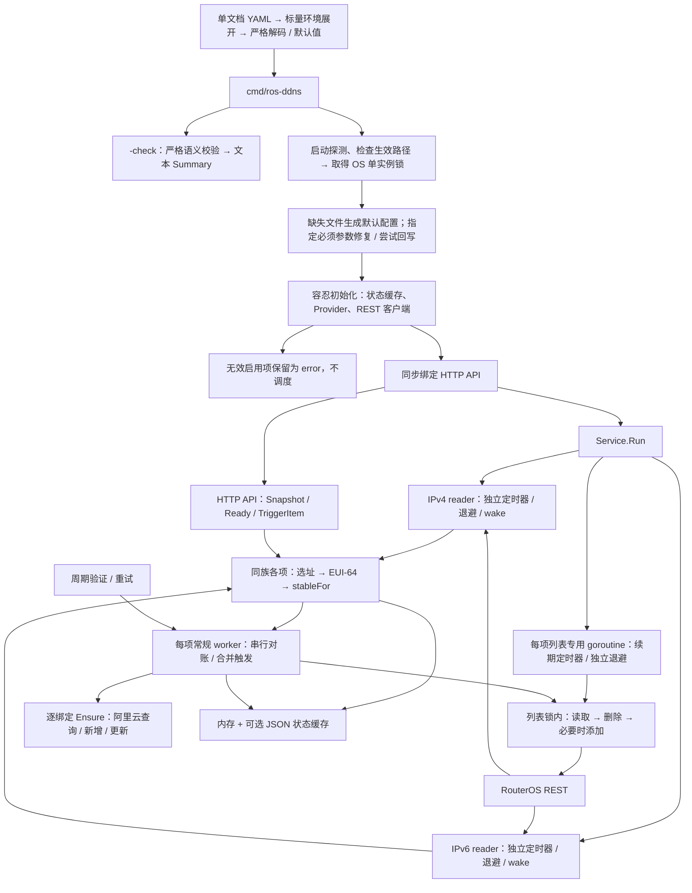
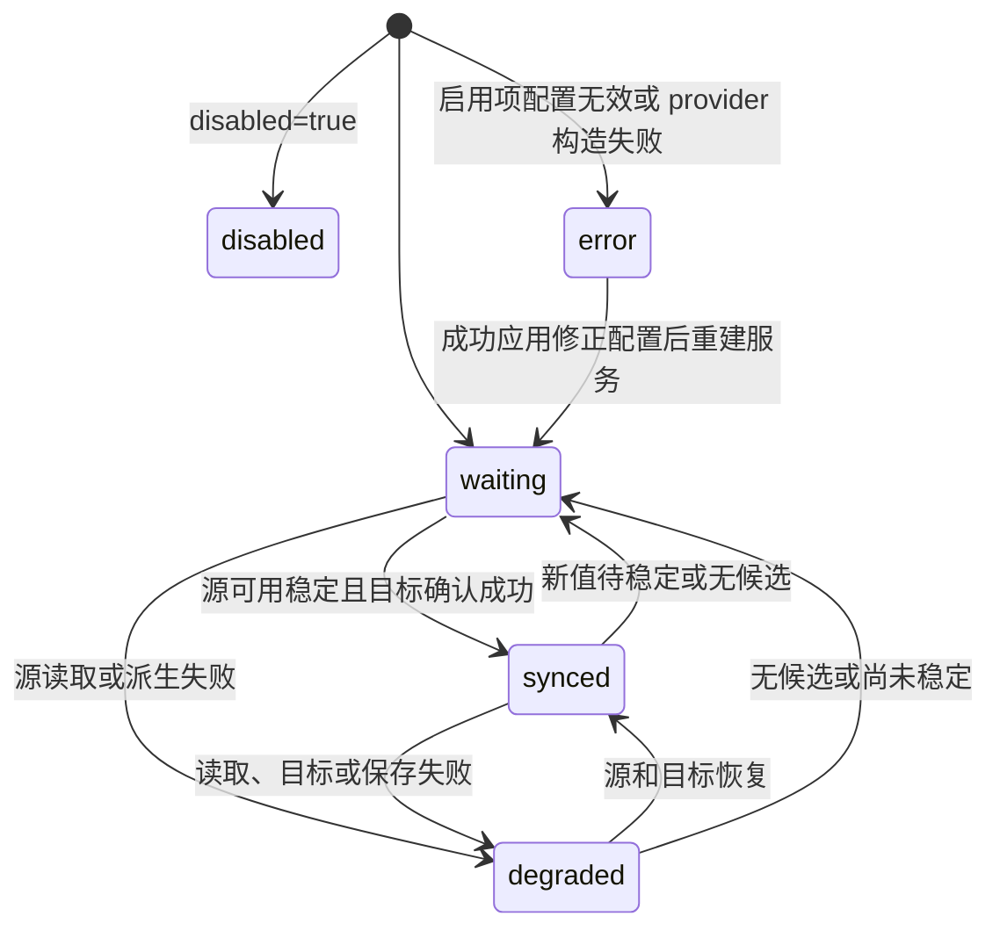

# 架构设计

`ros-ddns` 在一个进程内连接一台 RouterOS，为每个有效的启用条目计算一个地址值，再维护其 DNS 绑定和可选地址列表。启动时配置不完整的条目保留为错误状态，其余有效条目继续运行。配置字段见 [配置参考](configuration.md)，操作命令见 [README](../README.md)。真实设备与云账号验证步骤见两份部署指南。

## 1. 组件与入口



| 组件 | 职责 |
| --- | --- |
| `internal/config` | 单文档严格解析、标量展开、默认值、严格校验、启动必须参数修复与 YAML 回写准备、错误清洗、文本摘要 |
| `internal/eui64` | 48 位 MAC 校验和 IPv6 IID 合成 |
| `internal/ros` | Basic Auth、TLS、REST 读写、地址过滤及排序 |
| `internal/dns/alidns` | 分页查找、身份匹配、upsert、多义保护、共享限速和请求重试 |
| `internal/service` | 启动时保留错误项、按族并发轮询、有效项调度、稳定窗口、对账、续期、错误脱敏、Snapshot |
| `internal/app` | 当前服务管理、严格配置保存事务、状态缓存与页内通知 |
| `internal/state` | 可恢复缓存及串行完整文件保存 |
| `internal/instancelock` | 非阻塞 OS 互斥、持有者诊断与锁生命周期 |
| `internal/api` | 探针、Bearer 认证、状态查询、手动排队、监听与关闭 |
| `cmd/ros-ddns` | 参数、日志、版本、静态校验、服务管理、信号处理和启动顺序 |

每个被有效启用项引用的 provider 名复用一个实例；同名实例的所有项共享限速。启动时 provider 构造失败只使引用它的项进入 error，不停止其余项。不同有效条目可以并行对账，同一条目的常规对账由操作锁保证串行。每个配置列表的有效启用项另有独立续期 goroutine，不调用 DNS provider，也不等待 DNS Ensure 或退避；常规对账和续期共享该项的列表锁，串行完成列表读取、增删和结果发布。网络请求期间不持有状态锁，因此状态查询和有效项的手动触发仍可进行。

## 2. 启动与停止

1. 解析参数；`-version` 可直接输出构建信息并退出，无需配置。
2. 只读探测配置，按启动规则计算生效的必须参数，再按文件身份检查配置、`.bak`、非空状态路径和拟用锁路径互不重合；此时不回写、不创建或截断文件。YAML 语法、多文档、重复键、未知字段、环境展开及类型 / 解码错误均致命，手动退出 `2` / 服务退出 `1`，原文件保持不变。`-check` 另走严格加载与语义校验，检查路径后输出 Summary；不自动修复、不获取锁、不生成或修改配置、不初始化服务，也不读取 CA 文件或连接外部系统。
3. 取得单实例锁。优先使用 `-lock-file`，否则为探测所得生效 `state.path + ".lock"`；仅配置缺失时先用配置目录下的 `state.json.lock`；显式空状态路径的内存模式使用规范配置路径（绝对路径、解析符号链接，Windows 统一大小写）SHA-256 前 8 字节派生的临时路径。Windows 使用 `LockFileEx`，Unix 使用非阻塞独占 `flock`；获取失败退出 `1`。OS 锁成功后才写入 PID、启动时间、配置路径和版本的诊断 JSON。
4. 在锁内重新读取配置；仅文件缺失时生成内嵌默认配置。已存在文件中指定必须参数的语义非法值回退默认，并尝试先备份到 `.bak`、保留原权限后原子回写；成功解码的环境占位符非法值通常只在内存回退。非回环监听缺少合法 token 时自动生成 32 字节随机数的 hex token，即使原值是占位符也尝试写回字面值。回写失败记录 WARN / `config_autofix` 通知，继续使用内存修正值；不会以默认文件替换无法解析的配置。完整修复范围与例外见 [启动期自动修复与回写](configuration.md#11-启动期自动修复与回写)。
5. 重新检查配置、`.bak`、状态与有效锁路径的文件身份，并核对有效锁路径与当前持有的锁路径；锁路径不一致则退出，并提示用显式 `-lock-file` 固定锁路径。
6. 设置 stderr 日志，报告启动修复；自动生成的 token 在安装日志脱敏器之前打印一次，服务方式还写入 OS 服务日志。通知不包含 token 明文。以启动容忍方式初始化状态 Store、provider 和 REST 客户端：状态打开失败 WARN 并使用仅内存缓存；无效启用项及 provider 构造失败的引用项标 error；RouterOS 配置 / 客户端构造错误交给后续轮询退避。此阶段可能读取状态文件 / CA 文件，但不发起源轮询或目标写入。`http://` RouterOS URL 会产生明文连接告警（受运行日志级别控制）。
7. 守护进程先同步调用 API Listen，成功后才启动 HTTP Serve 和 Service.Run。绑定失败返回退出码 `1`，不会轮询或写 RouterOS。
8. SIGINT / SIGTERM 取消运行 context；轮询器、worker、定时器和请求停止，HTTP 关闭监听并给进行中的请求最多 10 秒完成。HTTP 服务异常也会取消服务运行。退出路径释放 OS 锁并关闭文件；关闭失败记录告警，进程退出也由内核释放锁。锁文件保留以免 Unix unlink 造成不同 inode 的并发锁；旧 JSON 不影响下次获取。

锁在整个进程运行期间保持，配置热重载不会重新获取或移动它；服务安装记录的启动参数与 Docker 启动命令用显式 `-lock-file` 把它固定在持久目录，手工运行需沿用同一路径。锁的精确路径规则、权限、服务管理目录与运维限制见 [生产部署](deployment.md#1-单实例锁)。它只协调使用同一文件的进程，不检测其他主机或不同路径上的远端目标重叠。

退出码 `0` 表示正常完成（含正常停止与无错误的 `-check`）；`1` 表示获取锁、生成默认配置、无法继续的初始化、监听或运行失败，也用于服务方式的致命配置错误；`2` 表示参数错误、`-check` 失败或手动启动的致命配置错误。非空非法 `api.listen` 是致命配置错误，端口绑定失败在两种启动方式下均退出 `1`。自动修复、回写失败、无效同步项和可退避的源 / 目标失败不单独导致进程退出。

配置分级中，`log`、`runtime`、`state`、`api` 是必须参数组，缺失或 `null` 通常使用默认值；`routeros`、`dns`、`items` 等可以不完整而不阻止启动。严格入口仍执行语义校验：无启用项时允许 routeros 全空，只校验已提供值的格式；有启用项时要求 URL、用户名并完整校验。禁用项只校验 name 非空、格式与全局唯一，允许未完成草稿；已定义 provider 仍校验 type / endpoint / timeout / qps，AK / Secret 可空，目标冲突只检查启用项。WebUI 保存与 PUT 不使用启动容忍路径。

## 3. 数据流与选址

配置无 version；记录类型由 family 派生，只有 provider 使用 `type: aliyun`。有效启用项至少有一个 DNS 绑定或一个列表目标，禁用草稿可不完整。

1. IPv4 从 `/rest/ip/address`、IPv6 从 `/rest/ipv6/address` 读取。仅有效启用项需要的地址族参与轮询，每次同族读取结果分发给同族运行项；启动时标为 error 的项不参与。
2. 匹配 interface 或 actual-interface，排除 disabled / invalid 和无效前缀，再按 scope、可选 prefix 过滤。
3. 候选按 IP 数值升序排列，取从零开始的 index。无候选或越界返回 `no eligible address`，不会退到第一个候选。
4. 未设 MAC 时用源地址的 IP 部分；设 MAC 时由前 64 位与 EUI-64 IID 合成 IPv6。
5. 观察值通过稳定窗口后成为期望值。DNS 和列表共用这个期望值。

两种 scope 均排除链路本地、回环、组播、未指定地址、IPv4 有限广播和依据源掩码计算的定向广播（`/31`、`/32` 除外），也排除 IPv6 link-local 标志。`public` 额外排除 IPv4 私网 / CGNAT；IPv6 还须 global、非 deprecated、非 ULA。`any` 放宽这些额外条件。它们是过滤规则，不是公网可达性检测。

`sourceAddress` 是最后选中的基础地址（含掩码），`recordValue` 是最后计算出的观察值，可能尚未稳定。域名 `value` 则是上次确认的目标值；不能因为二者暂时不同就认定数据损坏。

## 4. 调度、稳定窗口与续期

### 4.1 按地址族并发轮询

IPv4、IPv6 各有 reader goroutine、定时器、退避和容量为 1 的 wake 通道；一个地址族缓慢或失败不会阻塞另一个的观察。成功后恢复 `pollInterval`，失败每轮记录 WARN，按本族退避继续下一轮，并由页内通知报告项目错误变化。RouterOS 配置不全或客户端构造失败也进入这条错误路径；修正配置并成功保存或重启后才重新构造客户端。

失败时保留旧快照供状态参考，但不向选择器提交旧快照作为新观察。对应项将源标记为不可用，停止发起新的目标对账；已经发出的请求可能仍完成。成功读取但无合格地址同样阻止新写入，不主动清空既有 DNS / 列表。

### 4.2 稳定窗口

默认 `stableFor: 0s`，首次观察即可接受新值。正值从首次看到新候选时计时，后续成功轮询仍得到相同值且经过足够时间才接受；没有单独的“时间到就接受”任务。

候选变化、无候选或轮询失败会重置尚未接受候选的窗口。已接受期望值保留，恢复看到该值不必当作新地址重新防抖。缓存不能代替本次运行的新源轮询。

### 4.3 对账触发

| 触发 | 行为 |
| --- | --- |
| 新稳定值 / 未确认目标恢复可用 | 处理未确认当前期望值的目标 |
| `syncOnStart: true` | 首次获得可用稳定值后强制检查全部目标 |
| `verifyInterval` | 默认每 `10m` 强制检查全部目标；`0s` 只关闭此周期任务 |
| `TriggerItem(name)` | 合并一次强制请求，唤醒全部已使用地址族并清零各族退避；未知 / 禁用 / 配置错误项拒绝 |
| 目标失败退避到期 | 重试未确认目标，跳过已成功的目标 |
| 动态列表续期到期 | 独立列表 worker 刷新列表，不调用 DNS，也不进入常规对账队列 |

强制只绕过目标缓存，不绕过源选择及 stableFor。`syncOnStart: false` 仍会同步新值、无缓存或失效目标。普通轮询在值不变时不反复访问已确认目标；强制对账查询一致时也不一定发写请求。强制检查因源变化、失效或预算耗尽而中断时，保留尚未完成的检查需求；源恢复可用后继续，允许跨多轮完成全部目标。

### 4.4 动态列表定时器

成功确认受管动态列表后，独立列表 worker 通常按配置期限约一半安排续期。定时器使用单调时钟，不等待下一次源轮询，也不依赖全目标周期验证；极短期限有调度下限和到期前余量保护。动态条目的期限为空、无法解析或不大于 `1ns` 时，无法据此安排有效的到期前续期，改为有界复查：取正 verifyInterval 与 1 分钟的较小值；关闭周期验证时使用 1 分钟。

续期定时器到期后读取列表，将受管动态项删除并重新添加以刷新期限。续期只处理列表，使用独立的 reconcileTimeout 请求预算；列表操作仍与常规对账中的列表操作串行。静态受管项没有续期任务。外部启用的静态匹配项满足存在性；外部 dynamic 匹配项通常按返回期限约一半安排复查，期限未知、为空或过短时使用上述回退间隔，永不修改外部条目。

续期使用最近有效、稳定的源状态；源已不可用时保留待刷新标记，等恢复后再处理。服务重启后待重查的列表由独立列表 worker 在源可用后立即处理，与启动 DNS 对账并行，不等待 DNS Ensure 完成。续期失败进入独立列表退避并再次尝试，不改变 DNS 的重试时机；若常规对账也报告失败，其普通目标重试仍可再次检查列表。临近到期时 RouterOS 不可达、源失效、程序暂停或请求耗时都可能导致先过期后重建，无法承诺连续存在。

## 5. 状态机与 ready



| phase | 含义 |
| --- | --- |
| `disabled` | 不参加轮询、对账或手动同步，仍出现在 Snapshot 中 |
| `error` | 启动时发现启用项配置错误或其 provider 无法构造；保留错误说明，不参加轮询、对账或手动同步 |
| `waiting` | 尚无可用稳定源或目标尚未完成；可能带 lastError |
| `degraded` | 源请求 / 派生失败，或源可用时存在目标 / 状态保存错误 |
| `synced` | 源可用，全部目标已确认符合当前期望值，且无当前错误 |

启动配置错误项保持 `error`，`lastError` 给出配置错误原因（如 `配置错误：...`），直到配置修正并重建服务；其余有效项照常运行。对于参与调度的项，状态判定优先考虑源：源请求 / 派生 degraded 优先；源不可用或尚未稳定时通常为 waiting，即使还保留目标错误。无合格地址就是 `waiting` 加 `lastError`，因此监控必须看错误字段，不能只看 phase。

Ready 要求没有启动配置错误项，并且所有运行的启用项在本次运行中至少完成一次成功源轮询；items 为空或全部禁用时无需轮询即可 ready。RouterOS 配置 / 客户端构造失败时无法完成首轮成功读取，ready 为 false。源响应为空数组、过滤后无候选、index 越界都计入成功轮询；不要求 DNS / 列表已同步，也不要求稳定窗口结束。磁盘缓存不计入，后续轮询失败不会撤销已经完成的标记。它表示启动观察完成，不是持续连接健康或目标一致性的证明。

## 6. 目标对账

### 6.1 DNS

常规对账中，同项 domains 从保存的下一绑定起点按配置顺序循环执行，随后执行列表；全部共用一次 `reconcileTimeout`。起点游标只在该项操作锁内访问。一个绑定失败仍继续尝试后续目标，已成功结果不回滚；总时限耗尽或 context 取消后不再发新请求，下轮优先从尚未获得调用机会的绑定继续。因此首个绑定持续耗尽预算时，后续绑定仍能在重试中获得执行机会，失败绑定也仍会重试。下一次普通重试跳过已确认当前值的目标。

每次 Ensure 前、返回后发布状态前，都复核源仍可用且 revision 与本轮捕获值一致；发现过期就停止后续目标，并保留待重试 / 强制检查需求。revision 可区分地址变更后又变回的情况。失败或过期的在途结果不清空上次确认的展示值，但会使对应跳过缓存失效，避免下一轮误认为已经确认；网络 I/O 不持状态锁。

Alidns Ensure 用 `DescribeSubDomainRecords` 分页读取（每页 100），在本地按 RR、类型、line 精确绑定，RR / 类型不区分大小写，line 区分大小写：

- 无匹配则 `AddDomainRecord`；唯一匹配则规范化 IP，并比较值、TTL、line，必要时 `UpdateDomainRecord`。
- 多条匹配时只允许缓存 RecordId 选择已经通过身份过滤的一条；无有效提示则返回 `ErrAmbiguousRecord`，拒绝新增或更新。
- 分页不完整、匹配记录没有 ID 等情况拒绝写入。
- `DISABLE` 只告警，不改变启用状态；值 / TTL 有差异时仍可更新。因此 synced 不保证 DNS 记录正在对外解析。

line 属于身份。换 line 后在新线路查找，无匹配则新增；不能用旧 RecordId 迁移另一线路的记录。移除绑定、改域名或换 provider 都没有删除及孤儿清理。

### 6.2 地址列表

对账读取对应 family / list，再按精确 comment 区分受管项和外部项。常规对账和独立续期都捕获源 revision，在读取列表后、每次删除 / 添加前及发布结果前复核源可用性和 revision；一旦过期就停止后续写入，保留待重查状态。只有裸 IP 或同地址的 `/32`、`/128` 主机路由才满足期望主机；`203.0.113.0/24` 不满足 `203.0.113.0`，即使地址部分相同。

| 现有条目 | 处理 |
| --- | --- |
| 受管旧地址或受管子网 | 删除 |
| 受管同主机但 disabled | 删除，必要时重新添加启用项 |
| 受管同主机、静态 / 动态不同或期限不等 | 删除，必要时按配置重建 |
| 受管同主机、启用且静态 / 动态标志及期限一致 | 保留；动态续期到期时仍重建 |
| 外部启用的同主机 | 满足存在性，避免重复添加；不接管其 comment / timeout |
| 外部禁用的同主机 | 报未解决冲突，使项 degraded，需人工启用或移除 |
| 其他外部条目 | 保留，不修改 |

受管项同时检查 `ListEntry.Dynamic` 和 timeout：静态配置要求 `Dynamic=false` 且返回 timeout 为空；非空 timeout 的动态配置要求 `Dynamic=true` 且期限匹配，否则删除并按需重建。非空期限按可解析时长比较，解析不了时比较字符串；`1h` 与 `01:00:00` 可相等，`1h` 与 `59m` 不相等。

先完成所有应删除的受管条目，再在缺少满足目标的启用项且没有错误时添加。删除失败阻止新增，避免旧值仍在时添加新值。REST 删除返回实际 HTTP 404 视为已不存在，文本中恰巧包含 `404` 不等于成功。REST `AddEntry` 对 HTTP 400 且 message / detail 含 `already have such entry` 的响应返回可识别的 `ros.ErrEntryExists` 错误（短语匹配不区分大小写）。服务将其记录为本轮失败，源可用时条目为 `degraded`，不会误报 `synced`；下次对账重新读取列表后，才能确认有效目标或报告仍存在的冲突。

删除后添加存在短暂无条目的窗口，添加失败可能扩大窗口；不保证去除所有重复条目。改 list / comment、移除配置或禁用项都不清理旧作用域。没有可用源时不主动删除，但 RouterOS 自身仍会使动态项到期。

## 7. EUI-64 派生

取基础 IPv6 的前 64 位，将 MAC 首字节 XOR `0x02`，在前三字节与后三字节之间插入 `FF FE`，形成 IID。源地址掩码不必是 `/64`，select.prefix 只是选址过滤器。

| 测试向量 | 值 |
| --- | --- |
| 基础地址 | `2001:db8:1234:5678:aaaa:bbbb:cccc:dddd` |
| MAC | `00:1A:2B:3C:4D:5E` |
| IID | `021a:2bff:fe3c:4d5e` |
| 结果 | `2001:db8:1234:5678:21a:2bff:fe3c:4d5e` |

该向量见 `internal/eui64/eui64_test.go`，文档地址不用于公网部署。启用项的非法 MAC 使严格校验失败；守护进程启动将该项标为 error 并停止其调度，其余有效项继续。运行时派生错误使项 degraded，均不回退基础地址。

程序只合成值，不给设备分配地址、不设置 NDP 或防火墙放行规则。目标必须实际使用该前缀和 IID；隐私地址或非 MAC IID 无法这样推断。手工验证见 [RouterOS 指南](routeros-setup.md#7-ipv6-与-eui-64-注意事项与验证)。

## 8. 失败与重试模型

| 层次 | 行为 |
| --- | --- |
| 启动配置 / provider 构造 | 无效启用项保留 error，不轮询或触发；有效项继续，ready 为 false；需修正配置并重建服务 |
| 源轮询 | 每族独立，失败初始延迟 pollInterval，连续失败翻倍至 maxBackoff，成功清零；受 routeros.timeout 限制 |
| 常规条目目标 | 初始 `min(5s, maxBackoff)`，翻倍，加最多 10% 正向抖动且不超过 maxBackoff；新期望值或强制请求重置 |
| 动态列表续期 | 失败后以独立退避重试，使用相同初始值、翻倍和抖动边界，不改变 DNS 重试时机；列表成功后清零，服务重新 Run 时重置 |
| Aliyun 请求 | 最多 3 次尝试含首次；Throttling、5xx、网络错误 / EOF 可重试，约等待 1s、2s 加最多 25% 抖动 |
| Aliyun 限速 | 每个实例所有操作共享 qps，默认 5，突发容量 1；SDK 自动重试关闭 |
| 权限、参数、多义 | Provider 不即时重试这些确定错误；服务仍按目标退避重试，需修正根因 |
| 状态写入 | 保留内存和远端成功结果，条目显示错误；后续 Put 重试保存完整缓存 |

请求、限速和退避受 context 取消约束。常规对账的多个绑定及列表共用总时限，分页和限流等待也消耗预算；绑定起点在预算耗尽 / 取消后推进，退避不会把每轮起点重新固定为第一个绑定。独立列表续期另有自己的时限。续期是尽力而为，RouterOS 故障、进程停止或路由器重启可能使动态条目过期 / 消失，恢复后再重建。DNS、列表及状态文件之间不存在跨系统事务。源复核和远端请求也不是原子操作：已经发出的请求仍可能在源变化后完成，复核只能阻止发现过期后的后续请求和成功确认；恢复后由新的对账收敛到当前期望值。

## 9. 状态持久化

`state.path` 缺失或 `null` 时默认 `./data/state.json`，相对进程工作目录；显式 `""` 是合法的仅内存模式，不触发启动修复。自动生成的配置模板另将默认路径设为配置目录下的绝对路径。JSON 文件内部 `version` 当前为 `1`，这是缓存协议，与没有 version 的用户配置分开。

缓存保存源身份、观察值、期望值、各绑定确认值 / TTL / RecordId、列表身份 / 结果和经过脱敏的错误。源配置变化使旧期望值不再复用；DNS 按身份恢复 RecordId，TTL 变化只使相应确认缓存失效。列表只有 family、list、comment、timeout 全部匹配才恢复展示结果，但所有恢复的列表缓存均标记为待重查，重读并确认前不能视为 synced；缓存不能证明条目仍存在或外部条目的实际期限。即使配置为静态，并同时设置 `syncOnStart: false`、`verifyInterval: 0s`，首次获得可用稳定源值的轮询仍会触发列表重读。续期时间不从磁盘恢复，须按新读取结果重新安排必要的续期 / 复查。

保存时在目标目录创建临时文件，写完整缩进 JSON、sync、关闭后 rename；目录和文件分别请求 `0700` / `0600` 权限，Windows 还需用 ACL 控制访问。Store 串行化保存，写失败仍保留新内存状态。

文件缺失从空缓存开始；损坏、不完整或内部版本不兼容时告警并忽略；权限等其他打开 / 读取错误在守护进程启动时 WARN 并退化为仅内存缓存，继续运行。严格热重载中若需打开新缓存而失败，则拒绝应用、保留旧服务。缓存丢失或无法读取不影响重新发现唯一 DNS 记录，但会失去多义消解用的 RecordId 提示。关闭启动与周期验证后，已缓存 DNS 的外部漂移可能长期不被发现；静态列表虽然重启时会重读，运行期间的外部漂移仍需新的对账触发。动态列表独立续期仍有效。

## 10. HTTP API 与状态结构

WebUI 由 `web` 包通过 `go:embed` 内嵌，与 API 共用监听：`/` 提供页面，`/assets/*` 提供资源，无 Node 构建或外部 CDN。页面、静态资源和探针公开；页面的状态查询、配置读写、日志 / 通知历史及 SSE 使用下述认证。操作、截图与完整接口见 [WebUI 使用指南](webui.md)。

默认监听 `127.0.0.1:8080`。非空 token 保护 `/api/v1` 及其子路径，使用单个 `Authorization: Bearer <api.token>` 请求头；scheme 不区分大小写，credential 精确匹配。对 token 的 SHA-256 摘要做常量时间比较，重复 Authorization 头也拒绝。非回环监听在启动时缺少合法非空 token 会自动生成、尝试写回并打印一次；严格校验仍要求提供合法非空值。回环监听可用空 token。

| 路由 | 响应 |
| --- | --- |
| `GET /healthz` | 公开；`200 {"ok":true}` |
| `GET /readyz` | 公开；`200 {"ready":true}` 或 `503 {"ready":false}` |
| `GET /api/v1/meta` | `200`，版本、配置路径、进程启动时间 / uptime、日志级别、authRequired、ready |
| `GET /api/v1/status` | `200`，Snapshot JSON |
| `POST /api/v1/items/{name}/sync` | `202 {"status":"accepted","name":"..."}`；未知 / 禁用 / 配置错误项为 `404 {"error":"item not found"}` |
| `GET /api/v1/config` | `200 {path, data, hash}`；未展开环境引用的完整结构；已设置的 `api.token` 以掩码返回，其他字面量凭据仍可能可见 |
| `POST /api/v1/config/validate` | 接收 JSON `{data}`；`200 {valid:true}` 或 `200 {valid:false, errors:[...]}`；不保存 |
| `PUT /api/v1/config` | 接收 JSON `{baseHash, data}`；成功 `200 {snapshot, warnings}`，当前 `warnings` 为空数组；冲突 `409`，配置无效或需重启 `422` |
| `GET /api/v1/logs`、`GET /api/v1/logs/stream` | 历史 `{entries, next}` / SSE `log` 事件，序号为 `seq` |
| `GET /api/v1/notifications`、`GET /api/v1/notifications/stream` | 历史 `{events}` / SSE `notification` 事件，序号为 `id` |

认证失败为 `401 {"error":"unauthorized"}`，附 `WWW-Authenticate: Bearer`。普通响应及未知路由 `404` / 方法错误 `405` 返回 JSON，SSE 返回 `text/event-stream`。配置校验 / 保存仅接受不超过 1 MiB 的 JSON 请求体，格式、大小和 Content-Type 错误分别为 `400` / `413` / `415`。配置保存与手动 sync 在携带 Origin 时核对 scheme、主机及端口是否匹配请求（代理可用 `X-Forwarded-Proto`），不匹配返回 `403`；CLI 可省略 Origin。sync 不等待完成、不返回同步结果；到 status 查看后续状态，重载期间暂不接受 sync（返回 `404`）。

### WebUI、事件流与热重载

Dashboard 约每 2 秒轮询状态，标签页隐藏时暂停；Config 只用表单提交结构化对象。日志 / 通知先读取历史，再以流式 `fetch` 携带 Authorization 建立 SSE；服务端重放仍保留且大于 `after` 的记录，然后推送新记录，每 15 秒发送心跳。日志通过 `seq` 续读，通知页面通过历史补读与 ID 去重恢复；断线自动重连并暂用历史轮询。SSE 响应带 `X-Ros-DDNS-Started-At` 进程代际头；进程重启会重置内存日志 / 通知序号，页面检测到新进程后中止旧请求并清空旧游标。

`internal/logging` 将常规 slog 记录脱敏后同时写 stderr 和容量 2,000 的内存环形缓冲；启动生成 token 的一次日志在安装脱敏器前打印。`internal/notify` 保留最多 200 条事件；启动修复、token 生成及回写失败发布 warning 级 `config_autofix`，其中不含 token 明文。`internal/app` 每 2 秒观察项目错误变化并生成异常 / 恢复通知，同时发布配置应用结果，相同错误通知去重。缓冲在热重载时保留，进程重启后丢失；通知仅限页内 toast / 通知中心，没有浏览器系统通知、SMTP 或 Webhook。

守护进程由 `internal/app.Manager` 管理当前 Service，HTTP 处理器通过 Manager 查询和触发。配置 PUT 使用严格事务，明确关闭启动容忍：串行完成哈希检查、完整语义校验（含当前锁的路径冲突检查）与候选服务预先构造，再核对文件字节、保存 `.bak`、通过同目录临时文件替换配置，最后停止并等待旧 worker 全部退出，重新构造候选服务以读取最终缓存，再启动并切换新服务。校验或预先构造失败不改配置文件、保留旧服务；写入后的再次构造或切换失败尝试恢复原文件及旧配置服务，回滚失败也作为错误报告。后续常规轮询 / 对账失败由服务重试，不回滚配置。

阿里云 SDK 的每代 HTTP 连接池设置 90 秒空闲超时、总计最多 16 条空闲连接、每主机最多 4 条。永久弃用的服务代和 Manager 退出会主动关闭 provider 空闲连接；仍可能被回滚复用的旧服务保留连接池，关闭空闲连接也不禁用 provider 的后续使用。

RouterOS、providers、items、runtime、`state.path`、`log.level` 可在线应用；`api.listen`、`api.token`、`log.format` 的有效值变化需重启，表单只读且 PUT 拒绝。相同 `state.path` 复用缓存，变更时打开新缓存。重载期间 ready 为 false，切换后按新 Service 的首次成功源轮询重新建立 ready；保存成功不表示目标已同步。外部文件修改不会自动重载，`baseHash` 用于检测冲突（`409`），不是外部编辑器共享的文件锁。详见 [热重载语义](webui.md#4-热重载与就绪状态)。

### Snapshot 字段

Snapshot 字段：

| 层级 | 字段及类型 |
| --- | --- |
| 顶层 | `configPath` string、`startedAt` time、`items` array |
| `items[]` | `name` string、`disabled` bool、`family` string、`interface` string、`phase` string、`sourceAddress` string、`eui64Mac` string、`recordValue` string、`domains` array、`addressList` object、`lastError` string、`sourceObservedAt` time、`lastSyncAt` time、`nextPollAt` time |
| `items[].domains[]` | `provider` string、`fqdn` string、`type` string、`value` string、`recordId` string、`ttl` int、`line` string、`updatedAt` time、`lastError` string |
| `items[].addressList` | `list` string、`entries` array&lt;string&gt;、`updatedAt` time、`lastError` string |

Items 按配置顺序返回，包含禁用项及启动时保留的 error 项；错误项不参与轮询或触发。未配置列表时省略 addressList；标记 omitempty 的空字符串可省略，空数组返回 `[]`。time 是 RFC 3339 形式，可带小数秒；未建立的时间可能编码为 `0001-01-01T00:00:00Z`，不能当作有效观测。

`sourceObservedAt` 是最近一次选中基础地址的时间；`nextPollAt` 是源轮询计划而非目标重试 / 续期时间。域名 `updatedAt` 表示最近一次实际新增或修改记录值、TTL 或 line 的时间；仅确认未变化时保留历史值，未知时为零值。`lastSyncAt` 表示全部目标确认成功时间。列表 entries 是受管项及可匹配目标的外部项的地址字符串集合，排序去重；可能保留 `/32`、`/128` 或受管子网前缀，不包含逐条 disabled / timeout 属性。

以下是说明字段关系的节选示意，不是真实运行记录，也省略了时间字段：

```json
{
  "configPath": "build/configs/config.local.yaml",
  "items": [
    {
      "name": "home-ipv4",
      "disabled": false,
      "family": "ipv4",
      "interface": "pppoe-out1",
      "phase": "synced",
      "sourceAddress": "203.0.113.42/24",
      "recordValue": "203.0.113.42",
      "domains": [
        {"provider": "ali-main", "fqdn": "home.example.com", "type": "A", "value": "203.0.113.42", "recordId": "example-record-id", "ttl": 600, "line": "default"}
      ],
      "addressList": {"list": "ddns-home-ipv4", "entries": ["203.0.113.42"]}
    }
  ]
}
```

## 11. 脱敏与安全边界

服务错误写入日志、Snapshot 或缓存前，会替换已配置 RouterOS 密码、API token、AccessKey ID / Secret、STS token，并识别原值、JSON 字符串转义和 URL query 转义表示。长匹配值按子串处理，短匹配值要求两侧不紧邻 ASCII 字母或数字，替换为 `[redacted]`；重叠匹配一并处理，已有脱敏标记保持不变。配置加载器另外清洗环境展开值的错误，包括常见引号、换行转义、规范化和解码预览表示。

自动生成的 API token 在启动时、安装脱敏器之前打印一次，服务方式还写入 OS 服务日志；这是需要限制日志访问的明确例外。WebUI `config_autofix` 通知仅提示生成及回写结果和“见启动日志”，不包含 token。

这是对已配置凭据的脱敏，不保证任意上游内容或上述变体以外的编码形式都无秘密。状态与正常日志仍包含域名、IP、RecordId、接口、MAC 或路径，不能直接公开。不要将秘密放在 item 名、URL 路径或其他非凭据字段；限制 `state.path`、日志和配置的读取权限。

RouterOS 使用可信 HTTPS、专用账号和来源限制；comment 只是所有权约定，不是权限隔离。API 远程访问需限制网络来源并保护传输。项目没有多路由器连接、非 Aliyun provider、DNS 删除或 RouterOS 6 原生 API。
