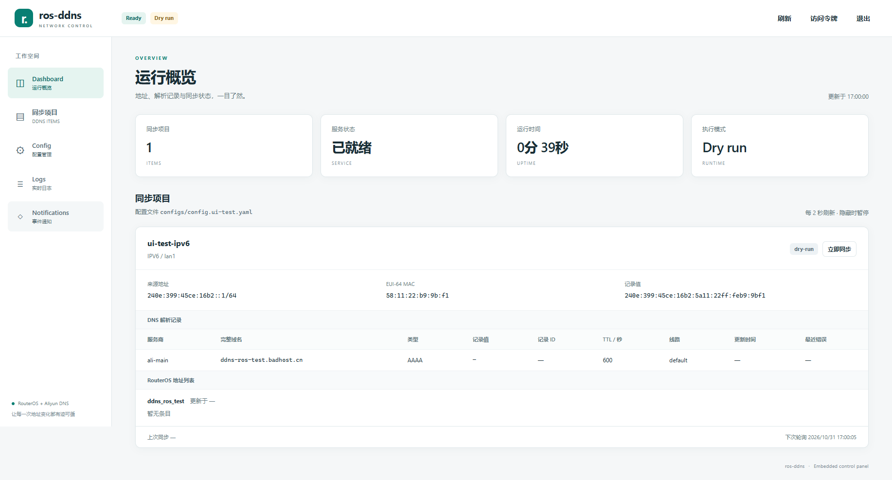
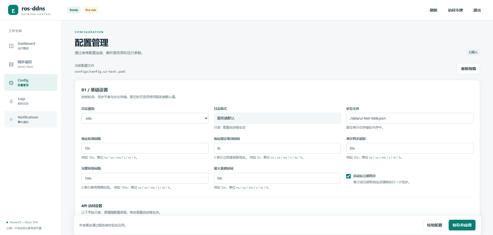
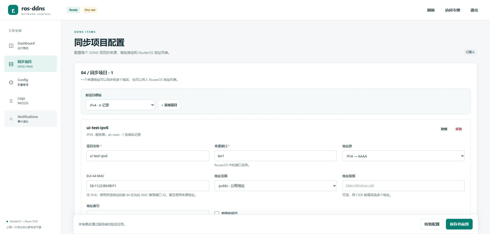
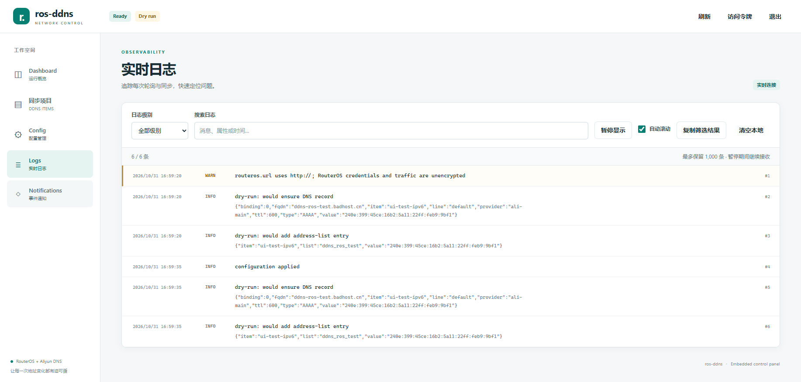
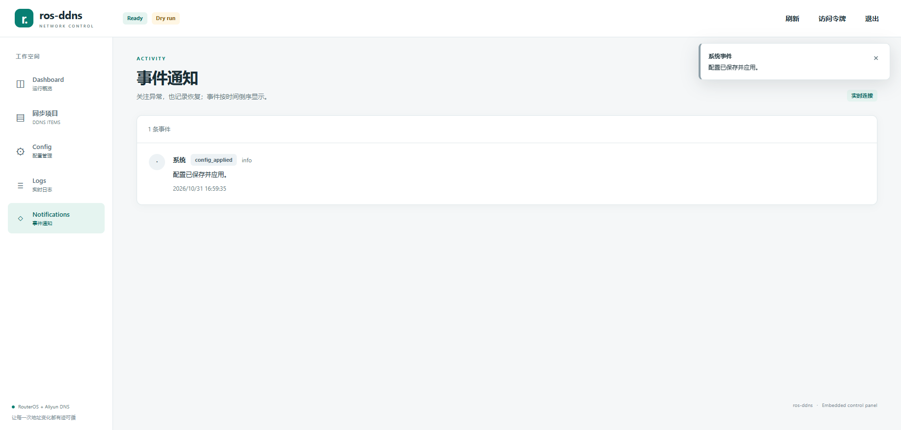

# WebUI 使用指南

WebUI 随 Go 二进制通过 `go:embed` 内嵌，与 HTTP API 共用 `api.listen`：`/` 提供页面，`/assets/*` 提供 JavaScript 和 CSS。构建、部署和运行均无需 Node 或单独的前端构建，也不依赖外部 CDN。界面支持桌面与窄屏布局，需要启用 JavaScript。

## 1. 启动与连接

先按 [README](../README.md#快速开始) 准备 RouterOS、凭据和配置。下面是配置示例；URL、接口、域名和 MAC 应按实际环境调整，`${ENV}` 由启动进程的环境变量提供，程序不自动读取 `.env`。RouterOS HTTPS 需使用可信证书，私有 CA 的设置见 [RouterOS 指南](routeros-setup.md)。

```yaml
log:
  level: info
  format: text
runtime:
  pollInterval: 10s
  stableFor: 0s
state:
  path: ./data/state.json
api:
  listen: 127.0.0.1:8080
  token: ${ROS_DDNS_API_TOKEN}
routeros:
  url: ${ROS_URL}
  username: ${ROS_USERNAME}
  password: ${ROS_PASSWORD}
  tls:
    insecureSkipVerify: false
dns:
  providers:
    ali-main:
      type: aliyun
      accessKeyId: ${ALI_ACCESS_KEY_ID}
      accessKeySecret: ${ALI_ACCESS_KEY_SECRET}
      securityToken: ${ALI_SECURITY_TOKEN:-}
items:
  - name: home-ipv6
    source:
      interface: lan1
      family: ipv6
      eui64-mac: "00:1A:2B:3C:4D:5E"
    domains:
      - provider: ali-main
        domain: example.com
        rr: home
        ttl: 600
    addressList:
      list: ddns-home-ipv6
```

保存为自己的配置文件后，在仓库根目录构建并启动：

```powershell
# Windows PowerShell
.\scripts\go.cmd build -o build/bin/ros-ddns.exe ./cmd/ros-ddns
.\build\bin\ros-ddns.exe -config build/configs/config.local.yaml
```

```bash
# Linux
go build -o build/bin/ros-ddns ./cmd/ros-ddns
./build/bin/ros-ddns -config build/configs/config.local.yaml
```

`-config` 指定配置路径，默认 `config.yaml`，相对当前工作目录。只加 `-check` 不会启动 API；启动 WebUI 请直接运行守护进程。配置文件不存在时，守护进程会自动生成默认配置（详见 [README](../README.md)）。

打开 `http://<api.listen>/`，默认是 `http://127.0.0.1:8080/`；通配监听地址需换成客户端可达的服务器地址。设置 `api.token` 后，在登录框输入令牌本身，无需加 `Bearer` 前缀。页面先尝试当前会话连接，收到 `401` 才要求登录；也可点击“访问令牌”。令牌仅存于当前标签页的 `sessionStorage`，退出会清除令牌和页面中的配置草稿。

只有回环监听允许空 token，此时可直接访问或选择“无令牌连接”；非回环监听必须配置非空 token。远程访问建议使用 HTTPS 反向代理并限制来源。代理应在站点根路径提供 UI 和 API，保留 `Host`、`Authorization`，允许 SSE 长连接并关闭响应缓冲；若 TLS 在代理终止，还需传递 `X-Forwarded-Proto`，否则保存 / 同步的同源检查可能因 scheme 不一致而拒绝。

## 2. 页面功能

### Dashboard：运行概览

每个 item 一张卡片，显示地址族、接口、阶段、来源地址 `sourceAddress`、EUI-64 MAC 和计算值 `recordValue`，以及域名绑定的值、RecordId、TTL、线路、更新时间和错误。解析记录表的「更新时间」仅在 DNS 实际新增/更新记录值、TTL 或 line 时刷新；仅确认未变化不会改变它。配置了 `addressList` 的项目还显示列表名、已有地址及列表错误。解析记录表中的完整域名和记录值旁有图标复制按钮；复制文本仍经过页面统一的脱敏处理。

状态快照约每 **2 秒**轮询一次，标签页隐藏时暂停，重新可见时恢复；断线保留上次快照并自动重试。全局元数据约每 30 秒刷新。`recordValue` 是观察或派生值，域名 `value` 是上次确认值，二者暂时不同可能是稳定等待、预演或同步失败。

“立即同步”排队一次强制对账并唤醒源轮询；`202` 只表示已接收，随后查看卡片及错误。强制同步仍要求源地址可用且通过 `stableFor`。Ready 的含义见 [热重载与就绪状态](#4-热重载与就绪状态)。



*Dashboard：真实 RouterOS `lan1` 的 IPv6 来源和 EUI-64 派生值。*

### Config：仅表单编辑

**配置页只提供表单，没有 YAML textarea，也没有 YAML 文本编辑模式。** 表单读取完整结构化配置，保留 `${ENV}` 引用；未编辑字段随原对象保留，再由服务端按完整配置校验。

| 分区 | 可操作内容 |
| --- | --- |
| 基础设置：`log` / `runtime` / `state` | 日志级别、轮询间隔、稳定等待、同步超时、完整校验间隔、最大退避、启动同步、状态路径 |
| API 与日志格式 | `api.listen`、`api.token`、`log.format` 只读，修改需编辑文件并重启；token 只显示“已设置 / 未设置”，不显示值 |
| RouterOS | URL、用户名、密码、请求超时、CA 文件、是否跳过 TLS 验证 |
| DNS 服务商 | 添加、重命名、移除 Aliyun provider；编辑 endpoint、regionId、AK / STS、超时和 QPS；重命名会更新域名引用 |

同步项目（`items`）以及其中的域名和地址列表，在左侧导航的 **「同步项目」** 页面单独编辑，不再放在 Config 页。两页共享同一份配置草稿与「校验配置 / 保存并应用」操作；在任意一页保存都会提交完整配置。

token 的“已设置”按未展开的配置字段判断；`${VAR:-}` 是否实际启用认证，以 `/api/v1/meta` 返回的 `authRequired` 为准。RouterOS 和 provider 凭据默认遮挡，支持主动显示；推荐继续填写环境引用。移除项目或绑定只改变配置，不会自动清理远端旧 DNS 记录或旧列表。配置 GET 不返回 `api.token` 原值（只返回掩码）；保存时服务端还原原始字符串引用（包括通过 YAML 合并键、别名和合并序列取得的引用）。未加引号的数字 / 布尔 / 时间戳 token 使用当前有效值，可能被规范化为字符串，但不会触发 token 变更；需要保留环境引用时请使用字符串写法，例如 `${ROS_DDNS_API_TOKEN}`。

1. 编辑后可点击“校验配置”：浏览器先检查必填项及基本格式，服务端再执行完整解析、环境展开和语义校验。此操作不保存、不重载，也不探测 RouterOS / DNS 连通性或权限。
2. 点击“保存并应用”：提交完整 `data` 与读取时的 `hash`（请求字段名为 `baseHash`），服务端重新校验、保存并热重载。成功后页面读取新配置版本；保存成功不等于目标已同步。
3. 保存会规范化 YAML，**注释、锚点及原排版可能丢失**；原文件完整字节备份到同路径加 `.bak`，例如 `build/configs/config.local.yaml.bak`。后续保存会覆盖这个备份，不形成版本历史。
4. 外部编辑使文件哈希变化时返回 `409`，不会覆盖该版本；页面保留草稿，并询问是否丢弃草稿、重新加载。选择取消可保留编辑，重新加载后需对照最新文件重新修改。不要让外部编辑器与 WebUI 同时写文件。

离开 Config 或「同步项目」页会提示未保存更改，并可保留草稿继续浏览；刷新、关闭页面或退出前应先保存。只读字段不能通过 API 绕过限制：改变它们的有效值会被拒绝，见下文 `422`。



*Config：基础设置、RouterOS、DNS 服务商和只读 API 设置；同步项目已移到左侧独立页面。*

### Items：同步项目

左侧导航的「同步项目」与 Dashboard、Config 同级，专门编辑 `items` 数组：

| 分区 | 可操作内容 |
| --- | --- |
| 来源 | IPv4 / IPv6 / EUI-64 模板；添加、复制、移除、停用；编辑接口、地址族、MAC、scope、prefix、index；副本默认停用 |
| 域名绑定 | 增删 `domains[]`，选择 provider、domain、rr、TTL、line |
| RouterOS 地址列表 | 开关 `addressList`，填写 list、timeout、comment |

同步项目页和 Config 页共享同一份草稿、字段校验和操作栏；在 Items 页修改后切到 Config 不会丢失草稿，保存仍会提交完整配置。移除项目或绑定只改变配置，不会自动清理远端旧 DNS 记录或旧列表。



*Items：同步项目列表、来源、域名绑定和地址列表编辑；与 Dashboard/Config 同为左侧一级入口。*

### Logs：历史与实时日志

页面先读取历史，再通过带认证的 SSE 接收新日志。可按 `debug` / `info` / `warn` / `error` 级别筛选，搜索消息、属性或时间，暂停显示、自动滚动、复制筛选结果或清空本地显示。页面级别筛选是精确匹配；服务端历史 API 的 `level` 是最低级别。只有达到当前 `log.level` 的日志才会被记录，前端筛选不能补回未记录的 debug 日志。

暂停显示期间仍接收数据，页面显示与暂停缓冲各最多保留 1,000 条，缓冲溢出会丢弃较早日志并提示。清空本地不清空服务端历史。连接中断会自动重连（退避至最多 30 秒），期间每 3 秒读取历史；日志按最后 `seq` 续读并去重。`401` 会停止连接并要求重新登录。



*Logs：实时连接、级别筛选和搜索。*

### Notifications：页内通知

通知中心按时间倒序展示配置应用成功 / 失败、项目异常及恢复等事件，并通过 SSE 接收更新；新事件触发页内 toast。事件不维护已读 / 未读状态，也没有“标为已读 / 全部已读”操作。项目监控约每 2 秒检查一次，重复的相同错误不会每轮重复通知，错误变化会产生新事件。恢复通知表示当前无错误，不保证 DNS 已写入或目标可达。

通知流断线后读取历史并按 ID 去重。**通知仅限页面 toast 和通知中心**，不调用浏览器 Notification API，不发送系统通知、SMTP 邮件或 Webhook。



*Notifications：`config_applied` 事件；截图展示配置应用成功时的通知。*

## 3. HTTP API 参考

设置 token 后，整个 `/api/v1` 及其子路径要求单个 `Authorization: Bearer <api.token>` 请求头，包含 meta、历史和 SSE。`/`、`/assets/*`、`/healthz`、`/readyz` 公开；静态页面公开不等于 API 数据公开。认证失败返回 `401 {"error":"unauthorized"}` 和 `WWW-Authenticate: Bearer`，不支持把 token 放入 URL 查询参数。

下表的对象用字段名表示结构，`data` 为完整配置对象，非局部补丁。普通响应为 `application/json; charset=utf-8`，SSE 为 `text/event-stream`。

| 方法与路径 | 请求 / 参数 | 成功响应 |
| --- | --- | --- |
| `GET /healthz` | 无认证 | `200 {"ok":true}` |
| `GET /readyz` | 无认证 | `200 {"ready":true}`；未就绪为 `503 {"ready":false}` |
| `GET /api/v1/meta` | 无参数 | `200`：`{version, configPath, startedAt, uptime, logLevel, uptimeSeconds, authRequired, ready}`；`uptime` 为纳秒数，`uptimeSeconds` 为秒数 |
| `GET /api/v1/status` | 无参数 | `200`：[Snapshot](architecture.md#10-http-api-与状态结构)，顶层为 `{configPath, startedAt, items}`；不含 `ready` |
| `POST /api/v1/items/{name}/sync` | 无需请求体 | `202 {"status":"accepted","name":"..."}`；到 status 查看结果 |
| `GET /api/v1/config` | 无参数 | `200`：`{path, data, hash}`，`data` 未展开环境引用；已设置的 `api.token` 以 `********` 掩码返回，其他字面量配置值仍可能可见；`hash` 是原文件字节的 SHA-256；`Cache-Control: no-store` |
| `POST /api/v1/config/validate` | JSON：`{data}` | `200 {"valid":true}`，或 `200 {"valid":false,"errors":["configuration validation failed"]}`；安全摘要不回显凭据 |
| `PUT /api/v1/config` | JSON：`{baseHash, data}` | `200`：`{snapshot, warnings}`；`warnings` 为字符串数组，当前保存成功时为空；成功反馈由 `config_applied` 事件提供 |
| `GET /api/v1/logs` | `after`、`limit`、`level` | `200`：`{entries:[{seq,time,level,message,attrs?}], next}`，按序号升序；`next` 是最后检查的序号，包含被级别过滤的记录 |
| `GET /api/v1/logs/stream` | `after` | `200` SSE：`event: log`，`id` 为 `seq`，`data` 为一条日志 JSON |
| `GET /api/v1/notifications` | `limit` | `200`：`{events:[{id,time,kind,severity,item?,phase?,message}]}`，取最新若干条并按 ID 升序返回 |
| `GET /api/v1/notifications/stream` | `after` | `200` SSE：`event: notification`，`id` 为事件 ID，`data` 为一条通知 JSON |

`after` 缺省为 `0`，须为无符号 64 位整数，读取大于该序号 / ID 的保留记录。两种历史接口的 `limit` 缺省为 `200`，非正数使用缺省值，最多 `1000`；通知历史没有 `after` 分页参数。日志历史 `level` 缺省为 `info`，可取 `debug`、`info`、`warn`、`error`。时间为 RFC 3339 字符串，可带小数秒。

SSE 先重放尚保留且大于 `after` 的记录，再推送新记录，每 15 秒发送 `: ping` 心跳。WebUI 使用 **流式 `fetch` 携带 Authorization**，不使用原生 `EventSource`。日志流带最后 `seq` 重连；通知页面先读取 `limit=200` 历史，再以最后事件 ID 作为 `after` 续流并去重，避免把历史事件重复弹成 toast。服务端接受 `after` 查询参数，不依赖 `Last-Event-ID` 请求头，并在 SSE 响应头返回 `X-Ros-DDNS-Started-At` 作为进程代际标识。每次 SSE 写入有 30 秒期限，心跳会持续刷新；不消费数据的客户端会被关闭。缓存淘汰或慢消费者可能丢记录，不保证完整历史回放。
进程重启后日志 `seq` 和通知 ID 会从 0 重新开始；页面在重连时比较 `/api/v1/meta.startedAt` 与 SSE 的 `X-Ros-DDNS-Started-At`，检测到新进程后中止旧请求、清空旧游标和旧事件，并开始新的历史 / SSE 连接，避免旧游标吞掉新日志 / 通知或重复播放旧事件。

| 状态码 | 条件 |
| --- | --- |
| `400` | JSON 无效、多个 JSON 值、外层未知字段、`data` 不是对象、缺少 / 非字符串 `baseHash`，或历史 / 流参数格式错误 |
| `401` | 设置了 token，但 Bearer 头缺失、无效或重复 |
| `403` | 保存配置或手动同步请求携带的 `Origin` 未通过来源检查 |
| `404` / `405` | 路由不存在 / 方法不支持；sync 的未知、禁用项目或重载期间不可触发时也返回 `404` |
| `409` | `baseHash` 为空或与当前文件不符，含候选服务构造期间检测到的外部编辑 |
| `413` | 配置校验 / 保存请求体超过 1 MiB |
| `415` | 配置校验 / 保存未使用单个有效的 `Content-Type: application/json` 头 |
| `422` | 保存的配置未通过完整校验，或改变了 `api.listen`、`api.token`、`log.format` 的有效值 |
| `500` / `503` | 配置读取 / 应用等内部失败，或所需服务不可用；`readyz` 未就绪为 `503` |

错误通常为 `{"error":"..."}`，包括路由 `404` / `405`。校验接口的业务校验失败仍为 **HTTP 200 + `valid:false`**，不要仅检查 HTTP 状态码。配置校验与保存都要求 JSON 对象，手动 sync 无需 JSON 请求体。

## 4. 热重载与就绪状态

| 配置范围 | 应用方式 |
| --- | --- |
| `routeros`、`dns.providers`、`items`、`runtime`、`state.path`、`log.level` | 通过“保存并应用”或配置 PUT 热重载，无需重启 Go 进程；运行服务会重新构造并切换 |
| `api.listen`、`api.token`、`log.format` | 页面只读；需在文件中修改并重启进程，PUT 不接受这些有效值的变化 |

Manager 串行处理保存：比对 `baseHash`、校验配置及文件路径冲突、预先构造候选服务、再次核对文件哈希，备份原文件为 `.bak`，通过同目录临时文件写入并 rename。随后停止并等待旧 worker 全部退出，重新构造候选服务以读取旧服务最后保存的状态，再启动并发布新服务；两代 worker 不重叠。即使 `syncOnStart: false` 且 `verifyInterval: 0s`，旧服务最后记录的失败也不会被旧的成功缓存覆盖。API 监听与日志 / 通知存储继续保留。同一 `state.path` 复用状态缓存，路径变化时打开新路径，不自动迁移旧缓存。状态路径不得与配置、`.bak` 或当前锁路径重合，冲突保存返回 `422`。

校验或预先构造失败时保留旧文件和服务；新文件写入后的再次构造或切换失败会尝试恢复原文件完整字节，并在旧服务已停止时重建、启动旧配置。回滚也可能遭遇文件系统或启动错误，应结合 API 错误、日志和就绪状态检查。后续普通 RouterOS / DNS 请求失败由服务重试，不触发配置回滚；保存不会等待远端同步成功。

重载过程中 `ready=false`。切换后，新服务须让所有启用项至少完成一次成功源轮询才能 ready；无候选地址也算成功轮询，状态缓存不算。之后源失败不会撤销该代服务已建立的 ready，因此应同时检查 `phase`、项目及目标的 `lastError`。需要即时就绪判断时使用 `/readyz`，页面全局元数据有刷新间隔。

程序没有文件监视自动重载：单独修改磁盘文件不会立即应用；页面“重新加载”只是读取文件，不切换服务。文件哈希用于冲突检测，外部编辑器不共享 Manager 的锁，仍应避免并发写入。`${ENV}` 在校验 / 应用时由现有进程环境展开；修改另一个终端或环境文件不会更新已运行进程的环境，凭据轮换需据此安排重启或更换配置引用。

## 5. 安全与数据边界

- 使用随机长 token，远程访问通过 HTTPS。登录令牌不放 URL、不使用 `localStorage`；持有单个 API token 即拥有配置读取、修改和同步权限。
- 页面及静态资源设置 CSP：默认、脚本、样式和连接限同源，图片允许同源和 `data:`，`frame-ancestors 'none'` 禁止被嵌入，`base-uri 'none'` 禁止更换基础 URL；同时设置 `X-Content-Type-Options: nosniff` 和 `Referrer-Policy: no-referrer`。页面内容按文本渲染。
- WebUI 向同源 API 发送请求。保存配置与手动同步带 `Origin` 时，服务端要求 Origin 的 scheme、主机及端口与请求一致（反向代理可通过 `X-Forwarded-Proto` 提供 scheme）；不带 Origin 的 CLI 请求允许通过，但仍须满足 Bearer 认证。配置校验 / 保存只接受 JSON；校验接口不写配置。
- **配置 GET 只对 API token 做掩码。** 它保留 `${ENV}` 占位符，并把 `api.token` 替换为 `********`；PUT 在应用前用当前文件中的真实值还原，因此表单可以只读保留该值，但其他字面密码、AK、STS 等仍会原样返回给已授权客户端。表单遮挡及 token 的设置状态并非通用数据访问隔离。推荐将秘密存入进程环境，并限制配置与 `.bak` 的文件权限。
- 状态 API 没有凭据字段；服务对错误中的已配置秘密脱敏，日志处理器在写 stderr 和内存日志流前清洗消息与属性，页面显示 / 复制时还有脱敏处理。不要把秘密写进名称、URL 路径或其他普通字段；任意上游文本和其他编码形式不在完整保证范围内。状态、日志、通知及截图仍可能包含 IP、域名、MAC、RecordId 或路径，分享前需检查。
- 服务端日志环形缓冲最多 **2,000 条**，通知最多 **200 条**，都只在内存中，溢出淘汰旧记录；进程重启后丢失，热重载不会清空。`state.path` 保存同步缓存，不保存日志或通知历史。

## 6. 验证与验收记录

仓库现有测试覆盖结构化配置、哈希冲突、重载失败与回滚、认证、静态资源、历史 / SSE、日志脱敏及通知状态转换。可在仓库根目录运行：

```powershell
# Windows：使用仓库内缓存
.\scripts\go.cmd test ./...
.\scripts\go.cmd vet ./...
# 检查自己的配置；不启动监听或连接外部系统
.\scripts\go.cmd run ./cmd/ros-ddns -config build/configs/config.local.yaml -check
```

```bash
# Linux
go test ./...
go vet ./...
go run ./cmd/ros-ddns -config build/configs/config.local.yaml -check
```

以下是 dry-run 模式移除前完成的真实 RouterOS Playwright 验收记录（该模式已移除，截图 header 可能仍显示 Dry run 徽标）：

1. 从真实 `lan1` 读取 IPv6，Dashboard 显示来源地址 `240e:399:45ce:16b2::1/64`；MAC `58:11:22:b9:9b:f1` 派生的 `recordValue` 为 `240e:399:45ce:16b2:5a11:22ff:feb9:9bf1`。这些是该次验收的观测值，不是部署默认值。
2. 将来源设为不存在的接口，出现无合格地址的错误状态；通过 Config **表单**修正回 `lan1`，保存并应用，完成热重载。
3. 重新读取到真实源地址后，项目恢复到无错误状态（当时为 dry-run 模式），并收到恢复通知 `item_recovery`；配置应用事件为 `config_applied`。通知截图展示的是配置应用事件。
4. 当时日志可见 `dry-run: would ensure DNS record` 和 `dry-run: would add address-list entry` 计划；该次验收没有写 DNS 或地址列表（dry-run 模式已移除，现行版本会执行真实对账）。表单保存仍会写配置文件与 `.bak`。

这次验收证明真实源读取、EUI-64 展示、表单修复、热重载和页内恢复通知链路。它不验证阿里云写权限、DNS 解析传播或 RouterOS 列表写权限；真实写入检查另见 [阿里云指南](aliyun-setup.md) 与 [RouterOS 指南](routeros-setup.md)。

## 7. 限制与范围

- 单个 API token，无多用户、角色或 RBAC；没有单独的只读账户。
- 只有表单配置编辑，没有 YAML 文本编辑器；保存不保留原 YAML 注释和排版。
- 只有页内 toast / 通知中心，没有浏览器系统通知、SMTP 或 Webhook。
- 日志和通知均为有限内存缓冲，无历史持久化、跨重启查询或完整回放保证；通知不维护已读状态。
- API 监听地址、API token 和日志格式需重启；没有文件监视自动重载，WebUI 也不管理进程环境变量。
